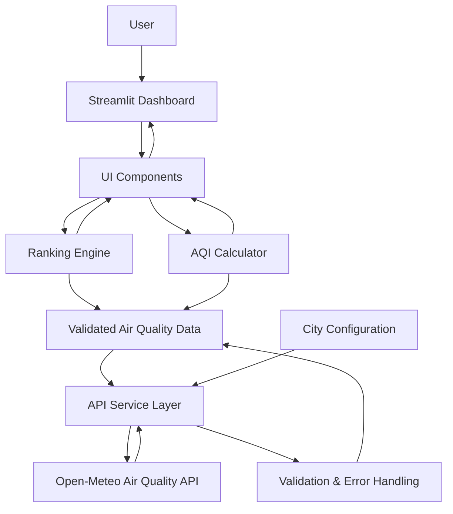
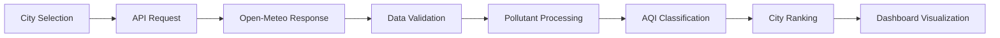

# Smog Watch PK 🌫️
### Pakistan Air Quality Monitoring Dashboard

A data-driven air quality monitoring dashboard designed to track, compare, and visualize air pollution across major urban centers in Pakistan.

Smog Watch PK integrates the **Open-Meteo Air Quality API** with Python and Streamlit to provide pollutant information, AQI classifications, pollution rankings, and health-related air quality insights through an interactive dashboard.

---

## Overview

Air pollution is a growing environmental and public health concern across Pakistan, particularly in densely populated urban areas.

**Smog Watch PK** provides a centralized platform for monitoring air quality indicators across multiple Pakistani cities. The application retrieves air-quality information from Open-Meteo, processes available pollutant data, evaluates pollution levels, and presents the results through interactive visualizations and health advisories.

The platform is designed with an emphasis on:

- Reliable API-based data retrieval
- Transparent data processing
- Clear air-quality classifications
- Comparative analysis between cities
- Responsive and accessible dashboard design
- Graceful handling of unavailable data

> **Data Transparency:** Open-Meteo air-quality values are based on atmospheric modeling and may not represent direct measurements from physical monitoring stations. Smog Watch PK displays API-provided information without fabricating pollutant values.

---

## Key Features

- **Multi-City Monitoring:** Monitor air quality across major Pakistani urban centers.
- **PM2.5 Monitoring:** Display fine particulate matter concentrations in μg/m³.
- **AQI Classification:** Categorize air quality into standard US AQI health categories.
- **Pollution Ranking:** Compare cities based on available pollution indicators.
- **Interactive Visualizations:** Explore pollution levels through interactive charts and dashboard components.
- **Health Advisories:** Present understandable health guidance based on AQI categories.
- **API Integration:** Retrieve air-quality information directly from Open-Meteo.
- **Data Validation:** Handle missing, invalid, and unavailable measurements safely.
- **Error Isolation:** Prevent individual city API failures from crashing the entire dashboard.
- **Manual Refresh:** Allow users to request updated information.
- **Caching:** Reduce unnecessary API requests through Streamlit caching.
- **Automated Testing:** Validate AQI calculations, ranking logic, and data-processing behavior.

---

## Monitored Urban Centers

Smog Watch PK is configured to monitor the following cities:

| City | Province / Region | Latitude | Longitude |
|---|---|---:|---:|
| Lahore | Punjab | 31.5204 | 74.3587 |
| Karachi | Sindh | 24.8607 | 67.0011 |
| Islamabad | Federal Capital | 33.6844 | 73.0479 |
| Faisalabad | Punjab | 31.4504 | 73.1350 |
| Peshawar | Khyber Pakhtunkhwa | 34.0151 | 71.5249 |
| Multan | Punjab | Configured | Configured |
| Gujranwala | Punjab | Configured | Configured |

The primary dashboard focuses on five major cities, while supplementary locations can be enabled through the project configuration.

---

## Technology Stack

| Technology | Purpose |
|---|---|
| Python | Application development and data processing |
| Streamlit | Interactive dashboard and user interface |
| Open-Meteo API | Air-quality data integration |
| Requests | HTTP communication |
| Pandas | Data processing and tabular analysis |
| Plotly | Interactive data visualization |
| Pytest | Automated testing |
| Git & GitHub | Version control and project management |
| Docker | Containerized deployment |

---

## System Architecture

Smog Watch PK follows a modular, layered architecture that separates user-interface responsibilities, business logic, data integration, and configuration.

### Architecture Overview



### Architectural Components

#### 1. Presentation Layer — `app.py`

The application entry point responsible for:

- Initializing the Streamlit dashboard
- Managing dashboard layout and user interactions
- Displaying city monitoring cards and summary metrics
- Rendering interactive charts and comparison tables
- Managing refresh operations and loading indicators
- Communicating API status and data availability

#### 2. UI Components Layer — `src/ui_components.py`

Contains reusable presentation components that maintain a consistent dashboard experience.

Responsibilities include:

- City information cards
- AQI status indicators
- Health advisory components
- Interactive Plotly charts
- Data comparison tables
- Reusable dashboard sections

#### 3. Business Logic Layer

**AQI Calculation — `src/aqi_calculator.py`**

Responsible for:

- AQI breakpoint configuration and interpolation
- Pollutant concentration processing
- AQI category determination
- Health advisory classification
- Handling unsupported or unavailable pollutant values

The calculator applies the US EPA breakpoint methodology when calculating AQI from supported pollutant concentrations.

**Ranking Engine — `src/ranking.py`**

Responsible for:

- Comparing available city pollution indicators
- Sorting cities by pollution severity
- Applying deterministic tie-breaking rules
- Excluding unavailable measurements from numerical rankings
- Preserving city availability information

#### 4. API Integration Layer — `src/api.py`

Provides a centralized interface for communicating with Open-Meteo.

Responsibilities include:

- Constructing API requests
- Supplying city coordinates and requested variables
- Managing request timeouts
- Handling HTTP and connection errors
- Implementing controlled retry mechanisms
- Parsing API responses
- Normalizing returned data
- Reporting individual city failures

This layer isolates external API communication from dashboard and calculation logic.

#### 5. Configuration Layer — `src/config.py`

Centralizes application configuration, including:

- City names and geographic coordinates
- API endpoint configuration
- Requested pollutant variables
- AQI breakpoint definitions
- Connection timeout settings
- Retry parameters
- Dashboard configuration values

Centralized configuration improves maintainability and makes adding new cities easier.

---

## Data Processing Workflow

The application follows this processing pipeline:



### Workflow Explanation

1. The application loads configured cities and their coordinates.
2. The API service requests available air-quality information.
3. Open-Meteo returns the requested atmospheric data.
4. The validation layer checks returned values and availability.
5. The AQI calculator processes supported pollutant concentrations.
6. The ranking engine compares cities with valid data.
7. Streamlit renders the results through dashboard components.
8. Users can refresh the dashboard to request updated information.

---

## Air Quality Index Classification

Smog Watch PK uses the following US AQI categories for health-related classification.

| US AQI | Category | Health Interpretation |
|---|---|---|
| 0–50 | Good | Air quality is satisfactory |
| 51–100 | Moderate | Acceptable; some sensitive individuals may be affected |
| 101–150 | Unhealthy for Sensitive Groups | Sensitive groups may experience health effects |
| 151–200 | Unhealthy | Health effects may occur for the general population |
| 201–300 | Very Unhealthy | Health alert conditions |
| 301–500 | Hazardous | Serious health effects may occur |

### AQI Calculation Methodology

When calculating US AQI from pollutant concentrations, the application uses the EPA piecewise linear interpolation methodology:

\[
I=\frac{I_{hi}-I_{lo}}{C_{hi}-C_{lo}}(C-C_{lo})+I_{lo}
\]

Where:

- \(I\) = calculated AQI
- \(C\) = pollutant concentration
- \(C_{lo}\), \(C_{hi}\) = concentration breakpoints
- \(I_{lo}\), \(I_{hi}\) = corresponding AQI breakpoints

The final AQI is rounded according to the applicable EPA calculation rules.

**Important:** AQI is pollutant-specific. A composite US AQI is determined by the highest applicable pollutant sub-index, rather than by averaging pollutant indices.

Where available, the application may also display the US AQI value directly provided by Open-Meteo.

---

## Data Integrity & Reliability

Smog Watch PK prioritizes transparent data handling and reliable application behavior.

### Data Integrity Principles

- No fabricated pollutant concentrations
- No synthetic values presented as real observations
- No automatic replacement of missing values with zero
- Explicit handling of unavailable API responses
- Validation of pollutant values before calculations
- Clear reporting of API errors and data availability
- Separation of data retrieval, processing, and visualization

### Error Handling

The application handles:

- API connection failures
- Request timeouts
- HTTP errors
- Invalid JSON responses
- Missing pollutant variables
- Null or invalid numeric values
- Individual city data unavailability
- Partial API failures

If a city cannot return valid data, its status is displayed as unavailable rather than generating misleading pollution statistics.

---

## Project Structure

```text
smog-watch/
│
├── app.py
│
├── src/
│   ├── __init__.py
│   ├── config.py
│   ├── api.py
│   ├── aqi_calculator.py
│   ├── ranking.py
│   └── ui_components.py
│
├── tests/
│   ├── __init__.py
│   ├── test_aqi_calculator.py
│   ├── test_ranking.py
│   └── test_api.py
│
├── assets/
│   └── screenshots/
│
├── .streamlit/
│   └── config.toml
│
├── Dockerfile
├── requirements.txt
├── .gitignore
├── README.md
└── LICENSE
```

### Directory Responsibilities

| Directory / File | Responsibility |
|---|---|
| `app.py` | Application entry point and dashboard orchestration |
| `src/config.py` | City, API, and AQI configuration |
| `src/api.py` | API requests, parsing, and error handling |
| `src/aqi_calculator.py` | AQI calculation and classification |
| `src/ranking.py` | City pollution ranking |
| `src/ui_components.py` | Reusable dashboard components |
| `tests/` | Automated tests |
| `assets/` | Project screenshots and visual assets |
| `Dockerfile` | Containerized application deployment |
| `requirements.txt` | Python dependencies |

---

## Getting Started

### Prerequisites

Ensure the following tools are installed:

- Python 3.10 or newer
- Git
- pip

### 1. Clone the Repository

```bash
git clone https://github.com/ghulam-mustafa-katbar/smog-watch.git
```

```bash
cd smog-watch
```

### 2. Create a Virtual Environment

**Windows:**

```bash
python -m venv .venv
.venv\Scripts\activate
```

**Linux / macOS:**

```bash
python3 -m venv .venv
source .venv/bin/activate
```

### 3. Install Dependencies

```bash
pip install -r requirements.txt
```

### 4. Launch the Application

```bash
streamlit run app.py
```

The dashboard will normally be available at:

```text
http://localhost:8501
```

---

## Testing

Smog Watch PK uses Pytest for automated testing.

Run the test suite:

```bash
pytest -v
```

Recommended test coverage includes:

- AQI breakpoint calculations
- AQI category boundaries
- Pollutant concentration validation
- City ranking and tie-breaking
- Missing and unavailable measurements
- Invalid numeric values
- API timeout handling
- API response validation
- Individual city failure handling

---

## Docker Deployment

The project supports containerized execution through Docker.

### Build the Image

```bash
docker build -t smog-watch-pk .
```

### Run the Container

```bash
docker run --rm -p 8501:8501 smog-watch-pk
```

Access the dashboard at:

```text
http://localhost:8501
```

---

## API Reference

**Data Provider:** Open-Meteo

**API:** Air Quality API

Endpoint:

```text
https://air-quality-api.open-meteo.com/v1/air-quality
```

Documentation:

https://open-meteo.com/en/docs/air-quality-api

### Data Variables

| Variable | Description | Unit |
|---|---|---|
| `pm2_5` | Fine particulate matter | μg/m³ |
| `us_aqi` | United States Air Quality Index | AQI |
| `european_aqi` | European Air Quality Index | AQI |

The application requests supported variables and processes the returned values according to their availability.

---

## Data Source & Attribution

Air-quality information is provided by:

**Open-Meteo**

https://open-meteo.com/

Air-quality modeling data is associated with the Copernicus Atmosphere Monitoring Service (CAMS).

https://atmosphere.copernicus.eu/

### Important Data Limitations

- Air-quality values are model-based estimates.
- Data may differ from readings collected by local physical monitoring stations.
- Spatial resolution may not represent conditions at every location within a city.
- Availability and freshness depend on the upstream provider.
- Historical and forecast information may differ from current modeled conditions.
- AQI values depend on the calculation methodology and pollutant concentration averaging period.

Smog Watch PK is an educational and analytical monitoring project and is not a substitute for official environmental monitoring or medical advice.

---

## Future Development

Potential future enhancements include:

- Historical air-quality trend analysis
- Time-series visualization
- Additional Pakistani cities
- Weather and meteorological indicators
- Automated pollution alerts
- Email and notification integrations
- GIS-based pollution visualization
- Satellite-derived air-quality analysis
- Official monitoring station integrations
- Exportable reports and datasets
- Mobile-friendly dashboard improvements

---

## License

This project is distributed under the license specified in the repository.

See the [LICENSE](LICENSE) file for details.

---

## Author

**Ghulam Mustafa Katbar**

Computer Systems Engineering Student  
Artificial Intelligence & Software Development

GitHub: [ghulam-mustafa-katbar](https://github.com/ghulam-mustafa-katbar)

---

<p align="center">
  <strong>Smog Watch PK</strong><br>
  Monitoring Air Quality. Understanding Pollution. Supporting Awareness.
</p>
